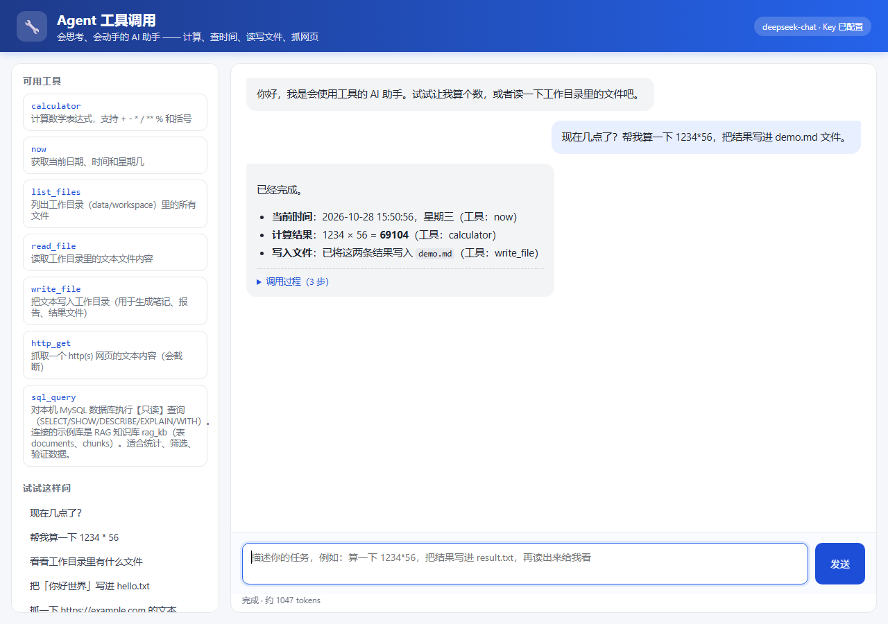

# Agent Toolkit · Function Calling Demo

> [中文版](README.md)

A hand-written **AI Agent** mini-project: the LLM decides on its own when to check the time, do math, read/write files, or fetch a web page — and every tool call is shown to the user.

> Job-hunting project 2/2: project 1 is [RAG Knowledge Base Q&A](../rag-knowledge-base). Together they cover the two core LLM-application skills: **retrieval augmentation** and **tool calling**.

- 🧠 **The model only decides**: OpenAI-compatible API + `function calling`
- 🛠️ **6 real tools**: calculator (safe `ast` evaluation), current time, list files, read file, write file, fetch URL
- 🔁 **Agent loop**: call tool → observe result → decide again, max 6 steps to prevent infinite loops
- 🔒 **Safety boundaries**: file tools are confined to the `data/workspace` sandbox; no arbitrary code execution
- 🖥️ **Visualized**: the frontend shows the "thought process" (which tool, arguments, result at every step)
- 🗂️ **Call logging**: every conversation and tool call is persisted to MySQL (`agent_runs` / `tool_calls`); the UI shows a "Recent runs" panel. Without a database it falls back to local JSONL, so tests and demos never break.
- ✅ **Testable**: tests run without a real model or network; GitHub Actions runs them automatically



## Quick start

```bash
# 1. Create and activate a virtual environment (Windows PowerShell)
python -m venv .venv
.venv\Scripts\activate

# 2. Install dependencies
pip install -r requirements.txt

# 3. Configure the key (copy the template, fill in your DeepSeek API Key)
copy .env.example .env

# 4. Run
uvicorn app.main:app --reload
```

Open <http://127.0.0.1:8000>. You can also run a real task right away:

```bash
python scripts/smoke.py
```

To enable MySQL call logging, set `AGENT_DB_*` in `.env` (create the `agent_toolkit` database and grant access — see "Call log"); without it, runs are written to `data/logs.jsonl`.

## How it works

```
User question
   │
   ▼
┌─────────────────────────────┐
│ Model (DeepSeek)            │
│ Output is either the final  │
│ answer or tool_calls        │
└──────────┬──────────────────┘
           │ tool_calls
           ▼
┌─────────────────────────────┐
│ Tool executor               │
│ calculator / now /          │
│ list_files / read_file /    │
│ write_file / http_get /     │
│ sql_query                   │
└──────────┬──────────────────┘
           │ observation (JSON)
           ▼
    Append the result as a
    role=tool message and
    call the model again
           │
           ▼
      until the model produces
      the final answer
```

- **Plain chat**: the model replies with text directly.
- **Agent**: the model may "call tools multiple times"; the program executes each call and feeds the result back until the task is done.
- **Parallel calls**: one model turn can request several tools at once — they run in a thread pool (up to 4 workers) and the observations are appended in the original order.
- **Read-only SQL**: `sql_query` talks to MySQL through the same `pymysql` connection settings as the call log; if no `SQL_DB_*` is configured it returns a friendly hint instead of failing.

## Built-in tools

| Tool | Description | Safety |
|---|---|---|
| `calculator` | Evaluate a math expression | `ast` whitelist, only `+ - * / ** %` and numbers, never `eval` |
| `now` | Current date / time / weekday | No side effects |
| `list_files` | List files in the workspace | Read-only, `data/workspace` only |
| `read_file` | Read a text file in the workspace | Path traversal rejected |
| `write_file` | Write a file in the workspace | Path sandbox + 200K character limit |
| `http_get` | Fetch a web page as text | http(s) only, 8 s timeout, truncated to 20K chars |
| `sql_query` | Read-only SQL against MySQL (`rag_kb`) | SELECT/SHOW/DESC/EXPLAIN/WITH only, single statement, no comments, LIMIT ≤ 200 |

## API

| Method | Path | Description |
|---|---|---|
| GET | `/api/health` | Health check + current model |
| GET | `/api/tools` | Tool list (used by the frontend sidebar) |
| POST | `/api/chat` | `{message, history}` → `{answer, steps, tokens}` |
| GET | `/api/logs?limit=20` | Recent runs `{storage, totals, runs}` |

Request example:

```bash
curl -X POST http://127.0.0.1:8000/api/chat \
  -H "Content-Type: application/json" \
  -d "{\"message\": \"算一下 1234*56，把结果写进 result.txt\"}"
```

Response example (excerpt):

```json
{
  "answer": "已经算好并写入 result.txt：1234 * 56 = 69104",
  "steps": [
    {"tool": "calculator", "args": {"expression": "1234*56"}, "result": {"ok": true, "result": 69104}},
    {"tool": "write_file", "args": {"name": "result.txt", "content": "1234*56=69104"}, "result": {"ok": true, "chars": 12}}
  ],
  "tokens": 512
}
```

## Call log (MySQL)

After every `/api/chat`, the run is written to two tables (DDL lives in `app/recorder.py`):

| Table | Purpose |
|---|---|
| `agent_runs` | One conversation: question, final answer, latency, tokens |
| `tool_calls` | Each tool step of that run: tool name, arguments, success flag, result preview |

`GET /api/logs?limit=20` returns the latest runs (newest first) — this powers the "Recent runs" panel in the UI.

Without `AGENT_DB_*` configured, or when MySQL is unreachable, it automatically falls back to `data/logs.jsonl`, so nothing breaks.

## Project structure

```
agent-toolkit/
├── app/
│   ├── main.py        # FastAPI entry (chat API, tool list, static page)
│   ├── agent.py       # Agent loop: model decision + tool execution + result feedback
│   ├── llm.py         # DeepSeek client wrapper (retries, tool_calls normalization)
│   ├── tools.py       # 7 tools + JSON Schema specs
│   ├── sql_tool.py    # Read-only MySQL query tool (validation + pymysql)
│   ├── recorder.py    # Call logging: MySQL, with JSONL fallback
│   └── config.py      # Environment configuration (including DB connection)
├── static/            # Chat UI (vanilla HTML/CSS/JS, no build step)
├── data/workspace/    # File-tool sandbox (files generated by the Agent go here)
├── data/logs.jsonl    # Fallback call log when no database is configured
├── tests/             # Three test layers: tools / agent / API
├── scripts/smoke.py   # Real-model smoke test
└── .github/workflows/ci.yml
```

## Tests

```bash
python -m pytest -q
```

Tests inject a scripted fake model via `monkeypatch`, so they need **no API key and no network**. Coverage:

- Calculator: normal / malicious / division-by-zero inputs
- File sandbox and path-traversal blocking
- Agent flow "call tool → feed back → answer", malformed arguments, step limit
- API health check, tool list, chat, parameter validation, model-error mapping
- Call log: both MySQL and JSONL backends (the MySQL integration test is skipped when no database is available)

## Design decisions

1. **Why not `eval`**: model output is untrusted — `__import__('os').system('rm -rf /')` would delete everything. Hence `ast` parsing + an operator whitelist.
2. **Why a sandbox**: file tools may only touch `data/workspace`; `Path.resolve()` checks whether the final path escapes, blocking `../` traversal.
3. **Why return tool errors to the model**: seeing `{"ok": false, "error": "路径越界"}` lets the model fix its arguments and retry — smarter than throwing at the user.
4. **Why limit steps**: the model can loop "call tool → fail → call again"; `AGENT_MAX_STEPS` is the last line of defense.
5. **Why tool descriptions matter**: `function.description` and parameter descriptions are instructions for the model — the more precise, the fewer wrong-tool calls.
6. **Why log calls**: debugging production means reading logs. `agent_runs` stores latency/tokens/steps per conversation; `tool_calls` stores each tool step with its result. When MySQL is down it degrades to JSONL so demos and tests never block.

## Next steps

- [ ] Parallel tool calls (execute multiple `tool_calls` concurrently)
- [x] Persist call logs (MySQL, automatic JSONL fallback)
- [ ] Rewrite the Agent loop with LangGraph (nodes + conditional edges + checkpoint memory)
- [ ] Add more practical tools (`read_pdf`, `search_web`, ...)
- [ ] Human-approval mode (confirm before writing/deleting files)
- [ ] Integrate the MCP protocol to reuse community tools

## Code reading order

A suggested reading order:

1. Run `python scripts/smoke.py` and watch which tools it calls (`data/workspace/calc.md` is created);
2. Read `app/tools.py`: each tool is just a plain function + a JSON Schema;
3. Read `run_agent` in `app/agent.py`: the Agent main loop, under 60 lines;
4. Read `app/main.py` and `app/recorder.py`: HTTP endpoints and call recording;
5. Add a new tool (e.g. `random_number`), then run the tests and the UI.

## License

[MIT](LICENSE)
