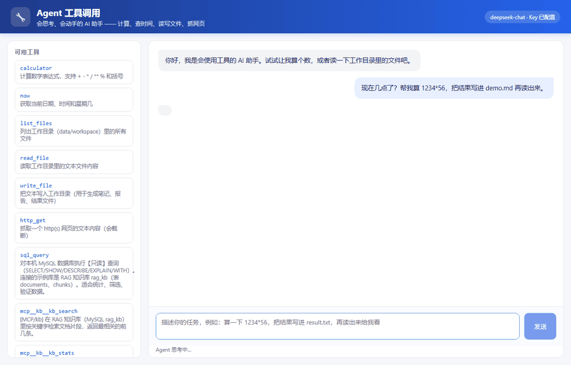
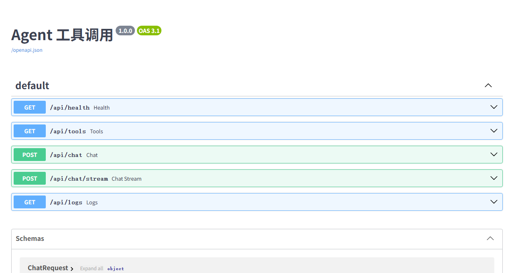
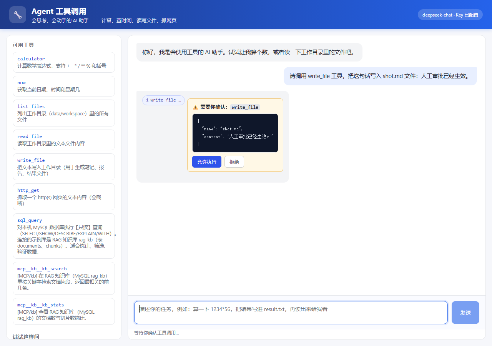

# Agent 工具调用 · Agent Toolkit

> [English version](README.en.md)



**🔗 [项目落地页](https://hdc233666.github.io/agent-toolkit/) · [在线演示](http://8.137.173.141:8011/?k=demo2026) · [架构图](docs/ARCHITECTURE.md)**

一个从零手写的 **AI Agent** 小项目：让大模型自己决定什么时候查时间、什么时候算数、什么时候读写文件、什么时候抓网页、什么时候查数据库，并把每一步工具调用都展示出来。

> 求职向项目 2/2：项目 1 是 [RAG 知识库问答](../rag-knowledge-base)，两个项目覆盖「检索增强」和「工具调用」两块大模型应用核心能力。

- 🧠 **模型只负责决策**：OpenAI 兼容接口 + `function calling`
- 🛠️ **9 个真实工具**：计算器（ast 安全求值）、当前时间、列文件、读文件、写文件、抓网页、只读 SQL 查询，外加 2 个通过 MCP 接入的知识库工具
- 🔁 **Agent 循环**：调工具 → 观察结果 → 再决策，最多 6 步，防止死循环
- 📡 **流式输出（SSE）**：工具执行过程和最终回答实时推给前端，回答像打字机一样逐字出现
- ⚡ **并行工具调用**：模型一次返回多个 `tool_calls` 时用线程池并发执行（属于 Function Calling 进阶用法）
- 🗄️ **SQL 工具**：`sql_query` 对 MySQL 示例库 `rag_kb` 做**只读**查询（白名单 + 禁写关键字），和 RAG 项目共用同一份数据
- 🔌 **MCP 工具服务器**：通过 stdio + JSON-RPC 连接外部工具服务器（自带一个 `kb` 服务器，暴露知识库检索/统计）；工具名以 `mcp__` 开头，服务器起不来只跳过、不影响本地工具
- 🔒 **安全边界**：文件工具被限制在 `data/workspace` 沙箱内，不执行任意代码
- 🖥️ **可视化**：前端直接展示「思考过程」（每步调了什么、参数、结果），回答支持 Markdown 渲染
- 🗂️ **调用记录**：每次对话与工具调用落库 MySQL（`agent_runs` / `tool_calls` 两张表），前端展示「最近记录」；没配数据库时自动降级为本地 JSONL，测试照样跑
- 🛡️ **人工审批**：`write_file` 等危险工具执行前挂起，界面点「允许」才执行（`AGENT_APPROVAL_TOOLS` 可配置，超时按拒绝处理）
- 🛡️ **限流与可观测**：按 IP 每分钟限流（`AGENT_RATE_LIMIT`，超限 429）、`/api/metrics` 暴露 Prometheus 指标、每个响应带 `X-Request-Id`
- ✅ **可测试**：不依赖真实模型和网络也能跑测试，GitHub Actions 自动跑

| 工具调用过程 | API 文档（Swagger UI） |
|---|---|
|  |  |

危险工具执行前的人工审批卡片：



## 快速开始

```bash
# 1. 创建并激活虚拟环境（Windows PowerShell）
python -m venv .venv
.venv\Scripts\activate

# 2. 安装依赖
pip install -r requirements.txt

# 3. 配置 Key（复制模板，填入你的 DeepSeek API Key）
copy .env.example .env

# 4. 启动
uvicorn app.main:app --reload
```

打开 <http://127.0.0.1:8000> 即可。也可以直接跑一个真实任务验证：

```bash
python scripts/smoke.py
```

想启用 MySQL 调用记录：在 `.env` 里填 `AGENT_DB_*`（建库 `agent_toolkit` 并授权，见「调用记录」一节）；不填时自动写入 `data/logs.jsonl`，不影响使用。

不想配环境？一条命令：

```bash
cp .env.example .env      # 填 DEEPSEEK_API_KEY
docker compose up -d --build
# 打开 http://127.0.0.1:8011/docs
```

`docker compose --profile mysql up -d` 会顺带起 MySQL，把调用记录写进 `agent_runs` / `tool_calls`（建表脚本见 `docs/init.sql`）。

架构图与设计取舍见 [`docs/ARCHITECTURE.md`](docs/ARCHITECTURE.md)，一页纸项目说明见 [`docs/PROJECT.md`](docs/PROJECT.md)。

## 工作流程

```
用户提问
   │
   ▼
┌─────────────────────────────┐
│ 模型（DeepSeek）              │
│ 输出要么是最终回答            │
│ 要么是 tool_calls            │
└──────────┬──────────────────┘
           │ tool_calls
           ▼
┌─────────────────────────────┐
│ 工具执行器（tool）           │
│ calculator / now /           │
│ list_files / read_file /     │
│ write_file / http_get        │
└──────────┬──────────────────┘
           │ 观察结果（JSON）
           ▼
   把结果作为 role=tool 消息
   放回对话，再次请求模型
           │
           ▼
      直到模型给出最终回答
```

- **普通聊天**：模型直接输出文本。
- **Agent**：模型可以「多次调用工具」，程序执行后把结果喂回模型，直到任务完成。

## 内置工具

| 工具 | 说明 | 安全措施 |
|---|---|---|
| `calculator` | 计算数学表达式 | ast 白名单，只允许 `+ - * / ** %` 和数字，绝不 `eval` |
| `now` | 当前日期/时间/星期 | 无副作用 |
| `list_files` | 列出工作目录文件 | 只读 `data/workspace` |
| `read_file` | 读取工作目录文本 | 路径越界直接拒绝 |
| `write_file` | 写入工作目录文件 | 路径沙箱 + 200K 字符上限 |
| `http_get` | 抓取网页文本 | 只允许 http(s)，8 秒超时，截断 20K 字符 |
| `sql_query` | 对 MySQL 示例库 `rag_kb` 做只读查询 | 白名单只放行 SELECT/SHOW/DESCRIBE/EXPLAIN/WITH；禁写关键字、限单语句、限 200 行 |

## MCP 工具（外部工具服务器）

`data/mcp_servers.json` 里声明 stdio 服务器，首次使用时会自动拉起：

```json
{
  "servers": [
    { "name": "kb", "command": "python", "args": ["-m", "app.mcp_server"], "enabled": true }
  ]
}
```

- 协议：JSON-RPC 2.0 over stdio，方法只有 `initialize` / `tools/list` / `tools/call` / `ping`（简化版 MCP，便于看清链路）；
- 工具命名：`mcp__<服务器>__<工具>`，例如 `mcp__kb__kb_search`；
- 自带 `app/mcp_server.py` 演示服务器，复用 `SQL_DB_*` 连接 RAG 项目的 `rag_kb`，提供 `kb_search`、`kb_stats`；
- 任何一个服务器启动失败/超时，只记录到 `/api/mcp/status` 的 `errors`，本地工具照常工作；
- 关闭：`MCP_ENABLED=0`。

## 接口

| 方法 | 路径 | 说明 |
|---|---|---|
| GET | `/api/health` | 健康检查 + 当前模型 |
| GET | `/api/tools` | 工具列表（本地 + MCP，前端侧边栏用） |
| GET | `/api/mcp/status` | MCP 服务器状态（工具数、启动错误） |
| POST | `/api/chat` | `{message, history}` → `{answer, steps, tokens}`（一次性返回） |
| POST | `/api/chat/stream` | 同上入参，**SSE 流式**：`tool_call` / `tool_result` / `delta` / `done` 事件 |
| GET | `/api/logs?limit=20` | 最近调用记录 `{storage, totals, runs}` |
| GET | `/api/metrics` | Prometheus 文本指标（对话数 / 工具调用数 / 错误数） |
| POST | `/api/approve` | 提交人工审批结果 `{approval_id, approve}`（前端审批卡片用） |

SSE 事件格式（`data: {...}`，每条事件一行 JSON）：

| 事件 | 载荷 | 含义 |
|---|---|---|
| `tool_call` | `{step, tool, args}` | 模型决定调用某个工具 |
| `tool_result` | `{step, ok, result}` | 工具执行完毕（结果同时回灌给模型） |
| `delta` | `{text}` | 回答的一段增量文本，前端逐字渲染 |
| `done` | `{answer, steps, tokens}` | 整轮结束，附带完整结果 |
| `error` | `{detail}` | 模型或工具出错 |

请求示例：

```bash
curl -N -X POST http://127.0.0.1:8000/api/chat/stream \
  -H "Content-Type: application/json" \
  -d "{\"message\": \"算一下 1234*56，把结果写进 result.txt\"}"
```

响应示例（节选）：

```json
{
  "answer": "已经算好并写入 result.txt：1234 * 56 = 69104",
  "steps": [
    {"tool": "calculator", "args": {"expression": "1234*56"}, "result": {"ok": true, "result": 69104}},
    {"tool": "write_file", "args": {"name": "result.txt", "content": "1234*56=69104"}, "result": {"ok": true, "chars": 12}}
  ],
  "tokens": 512
}
```

## 调用记录（MySQL）

每次对话结束（`/api/chat` 或 `/api/chat/stream`）后，把这次对话写入两张表（DDL 见 `app/recorder.py`）：

| 表 | 作用 |
|---|---|
| `agent_runs` | 一次对话：问题、最终回答、耗时、tokens |
| `tool_calls` | 这次对话里的每一步工具调用：工具名、参数、是否成功、结果摘要 |

`GET /api/logs?limit=20` 返回最近记录（时间倒序），前端「最近记录」面板就是调它。

没配置 `AGENT_DB_*` 或数据库连不上时，自动降级写入 `data/logs.jsonl`，功能不中断、测试不受影响。

## 目录结构

```
agent-toolkit/
├── app/
│   ├── main.py        # FastAPI 入口（对话接口、工具列表、静态页）
│   ├── agent.py       # Agent 循环：模型决策 + 工具执行 + 结果回灌
│   ├── llm.py         # DeepSeek 客户端封装（重试、tool_calls 归一化）
│   ├── tools.py       # 7 个本地工具 + JSON Schema 说明书（MCP 工具由 mcp_tools 动态合并）
│   ├── sql_tool.py    # SQL 只读查询工具（白名单校验 + 结果 JSON 化）
│   ├── recorder.py    # 调用记录：MySQL 落库，失败降级 JSONL
│   ├── mcp_client.py  # MCP 客户端：stdio 子进程 + JSON-RPC 2.0
│   ├── mcp_server.py  # 自带的 MCP 工具服务器（kb_search / kb_stats）
│   ├── mcp_tools.py   # MCP 服务器管理：加载配置、合并 mcp__ 工具、状态上报
│   ├── approvals.py   # 人工审批（写文件前确认，超时按拒绝）
│   ├── metrics.py     # 计数 / 延迟 / Prometheus 文本指标
│   ├── guard.py       # 演示访问保护（口令 + 每日额度）
│   └── config.py      # 环境变量配置（含数据库连接）
├── static/            # 聊天界面（原生 HTML/CSS/JS，无构建步骤）
├── data/workspace/    # 文件工具沙箱（Agent 生成的文件写在这里）
├── data/logs.jsonl    # 未配数据库时的调用记录降级文件
├── data/mcp_servers.json  # MCP 工具服务器清单
├── docs/
│   ├── ARCHITECTURE.md    # 架构图（Mermaid）+ 时序图 + 设计取舍
│   ├── PROJECT.md         # 一页纸项目说明
│   ├── init.sql           # MySQL 建表脚本（compose 自动执行）
│   └── screenshots/       # README 配图与演示 GIF
├── tests/             # 工具 / Agent / API 三层测试
├── scripts/smoke.py   # 真实模型冒烟测试
└── .github/workflows/ci.yml
```

## 工程指标（真实调用统计）

来自 MySQL `agent_runs` / `tool_calls` 表（20 次真实任务、51 次工具调用）：

| 指标 | 实测 |
|---|---|
| 单次任务平均耗时 | **3.4 s**（1–4 次模型请求 + 工具执行） |
| 单次任务最长耗时 | **9.1 s**（4 步链路） |
| 平均 token | **939** / 次 |
| 每次任务成本 | **≈ ¥0.003** |
| 并行工具调用 | 同一轮多个工具并发执行，耗时 ≈ max(单工具) 而非求和 |
| 调用记录 | 100% 落库（MySQL），无库时降级 JSONL |

```bash
# 查看真实调用统计
curl http://127.0.0.1:8011/api/logs?limit=20
```

## 测试

```bash
python -m pytest -q
```

测试通过 `monkeypatch` 注入脚本化假模型，**不需要 API Key 与网络**，覆盖：

- 计算器的正常/恶意/除零输入
- 文件沙箱与路径穿越拦截
- SQL 工具：只读白名单通过、写语句/多语句/注释藏写操作被拒、未配置数据源时明确报错
- Agent 的「调工具 → 回灌 → 回答」流程、坏参数、步数上限
- **多个工具调用的并行执行**（一次返回两个 `tool_calls`，顺序回填且都进入 steps）
- API 的健康检查、工具列表、对话、参数校验、模型错误映射
- **SSE 流式接口**：事件顺序（tool_call → tool_result → delta → done）、流中错误、调用记录照常落库
- 调用记录的 MySQL / JSONL 两种后端（MySQL 集成测试在没有数据库时自动跳过）

当前 **52 个用例**（含 MCP 服务器协议、客户端往返、挂载与降级、限流与指标测试）。

## 设计要点

1. **为什么不用 `eval`**：模型输出不可信，如果直接 `eval`，一句 `__import__('os').system('rm -rf /')` 就能删库。所以用 `ast` 解析 + 白名单运算符。
2. **为什么要沙箱**：文件工具只能访问 `data/workspace`，用 `Path.resolve()` 判断最终路径是否越界，防止 `../` 逃逸。
3. **为什么把工具错误返回给模型**：模型看到 `{"ok": false, "error": "路径越界"}` 后可以自己修正参数重试，这比直接把异常抛给用户更智能。
4. **为什么限制步数**：模型可能陷入「调工具 → 失败 → 再调」的死循环，`AGENT_MAX_STEPS` 是最后一道保险。
5. **为什么工具描述要写清楚**：`function.description` 和参数 `description` 是给模型看的说明，写得越具体，模型调错工具的概率越低。
6. **为什么要限流和指标**：Agent 一次任务可能调好几次模型，公开 demo 被刷就是真金白银；按 IP 限流 + 429 是成本底线。`/api/metrics` 让调用量、工具调用次数、错误数可被 Prometheus 抓取，演示「能观测」也算工程完整度。
7. **为什么危险工具要人工审批**：模型可能被提示词诱导执行越权操作，`write_file` 这类有副作用的工具先挂起、由人确认，才是生产级 Agent 的默认姿势；超时按拒绝处理，保证请求不会永久卡住。
8. **为什么要记录调用**：线上排查问题靠日志。`agent_runs` 记一次问答的耗时/tokens/步数，`tool_calls` 记每一步工具与结果，按时间倒序直接查。数据库连不上时降级写 JSONL，保证演示和测试不被环境卡住。
7. **为什么 SQL 工具要自己做白名单**：模型生成的 SQL 不能直接送进数据库——`DELETE`/`DROP` 一条就够出事。所以先去注释、再校验单语句、只放行只读前缀、按整词扫描写操作关键字，最后限行数、限超时；不合法就返回结构化错误让模型改写。
8. **为什么并行执行工具**：模型一次给出多个互不依赖的调用（比如同时查时间和算数）时，串行执行纯属浪费；线程池并发跑完再按原顺序回填，既快又不破坏协议的对应关系（`tool_call_id` 一一对应）。
9. **为什么要流式输出**：Agent 一步可能要等好几秒，全量返回前用户只能盯着「思考中」。改成 SSE 后，工具一执行就推送 `tool_call`/`tool_result`，回答边生成边推送 `delta`，前端进度与文字都是实时的，体验接近 ChatGPT；同时保留 `/api/chat` 一次性接口，方便脚本调用与测试。

10. **为什么要接 MCP**：工具写死在进程里，加一个工具就要改代码、重启。MCP 把工具变成「外部服务器」，Agent 只需按名字调用——换工具/加数据源不用动主程序。我按协议自己实现了 stdio 客户端与服务端：`initialize → tools/list → tools/call` 三步，工具名加 `mcp__` 前缀区分来源；服务器起不来只跳过并在 `/api/mcp/status` 里报错，主流程不受影响。这比「静态工具列表」更接近真实生产里的插件化架构。

## 已知局限

诚实说明，避免过度承诺：

- **单实例**：Agent 循环跑在单个 web 进程里，没有任务队列/worker；一个长任务会占住请求线程（靠 SSE 撑连接）。
- **审批状态在内存**：等待审批的挂起状态存在进程内字典，服务重启后未处理的审批会丢失（生产应落库 + 定时扫描超时）。
- **MCP 只支持 stdio**：本地子进程模式，没实现远程 MCP（HTTP/SSE）与鉴权，多 Server 编排也未做。
- **沙箱是"路径限制"不是"隔离"**：文件工具限制在 `data/workspace` 并拦截 `../`，但没有容器或系统权限隔离；真要执行不可信代码必须上沙箱。
- **工具级限流缺失**：只有接口级限流，没有按工具的调用配额；`http_get` 也没有 SSRF 黑名单（内网地址可访问）。
- **无多租户**：所有请求共用一份工具配置与同一个工作目录。
- **并发压测未做**：57 个测试覆盖功能与异常路径，但没做并发压测；Agent 场景的瓶颈通常在模型延迟而非服务吞吐。

## 下一步扩展

- [x] 多工具并行调用（一次返回多个 `tool_calls` 时并发执行）
- [x] SQL 只读查询工具（连 RAG 项目的 `rag_kb`，白名单防写操作）
- [x] 调用记录落库（MySQL，失败自动降级 `data/logs.jsonl`）
- [x] MCP 外部工具服务器（stdio + JSON-RPC，自带 kb 服务器，支持降级）
- [x] SSE 流式输出（工具进度 + 回答逐字推送）
- [ ] 用 LangGraph 重写 Agent 循环（节点 + 条件边 + 检查点记忆）
- [ ] 加上 `read_pdf` / `search_web` 等更实用的工具
- [x] 人工审批模式（写文件前挂起确认，`AGENT_APPROVAL_TOOLS`）
- [x] 接入 MCP 协议（内置知识库 MCP 服务器；接社区第三方工具待做）

## 代码阅读顺序

想快速理解代码，推荐按这个顺序：

1. 先跑通 `python scripts/smoke.py`，观察它调用了哪些工具（`data/workspace/calc.md` 会生成文件）；
2. 读 `app/tools.py`：每个工具就是一个普通函数 + 一份 JSON Schema；
3. 读 `app/agent.py` 的 `run_agent`：Agent 主循环，不到 60 行；
4. 读 `app/main.py` 与 `app/recorder.py`：HTTP 接口与调用记录；
5. 尝试新增一个工具（比如 `random_number`），跑一遍测试和页面。

## License

[MIT](LICENSE)


