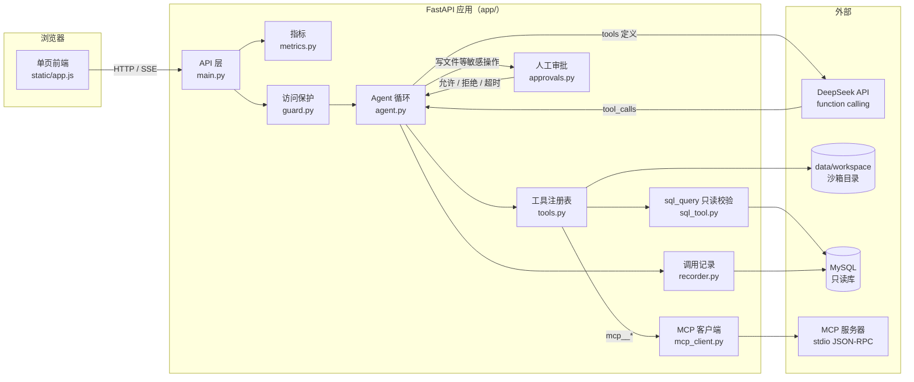
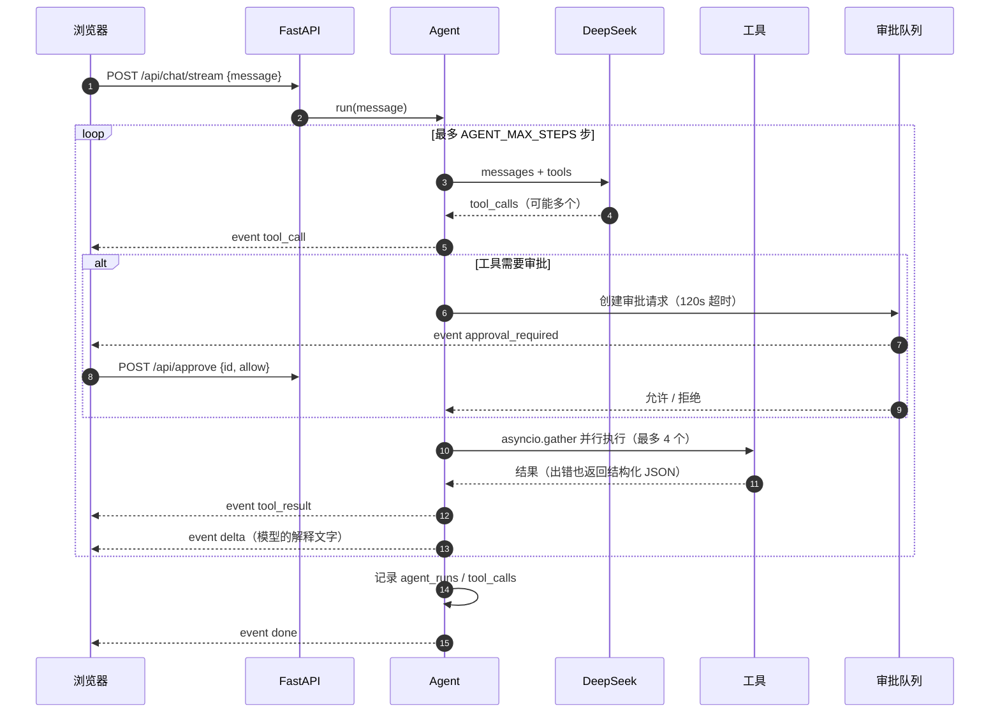
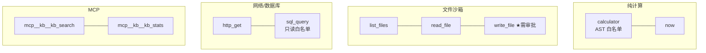
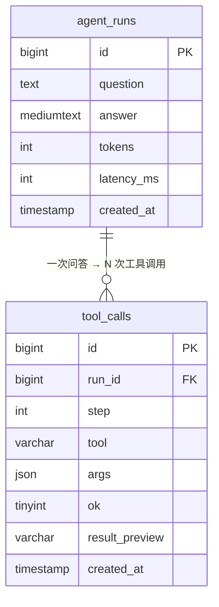

# 架构说明

> 这个项目的核心不是「能调工具」，而是**模型不可信时怎么安全地让它调工具**：沙箱、白名单、审批、步数上限、可观测。

## 1. 组件与边界

要点：

- **工具定义和实现放在一起**（`tools.py` 的注册表），模型看到的 `description` 就是这份代码里的文档字符串，改一个地方两边同步。
- **敏感工具不直接执行**：走 `approvals.py` 发一张审批卡，用户在页面上点「允许执行」才真正跑，超时按拒绝处理。
- **MCP 是外部工具的统一入口**：自写 stdio JSON-RPC 客户端，`mcp__kb__kb_search` 这类工具在启动时动态注册进注册表，模型看不出区别。

## 2. 一次带审批的调用时序

失败与边界：

- 工具报错不抛给用户，而是 `{"ok": false, "error": "..."}` 回灌给模型，让它自己修正参数重试；
- 步数到上限直接结束并说明原因，防止「调工具 → 失败 → 再调」死循环；
- 审批超时视为拒绝，会话继续（模型会解释「用户没批准」而不是卡住）。

## 3. 工具分层

★ `write_file` 默认在 `AGENT_APPROVAL_TOOLS` 里；文件路径统一用 `Path.resolve()` 判断是否越出 `data/workspace`。

## 4. 数据模型

没有配置 MySQL 时，同样的数据写进 `data/logs.jsonl`（一行一条），演示环境不会因为数据库缺失而丢记录。

## 5. 关键取舍（面试可讲）

| 决策 | 选了什么 | 为什么 | 代价 |
| --- | --- | --- | --- |
| 计算器 | AST 白名单，不用 `eval` | 模型输出不可信，`eval` 一行就能 `rm -rf`；白名单只认数字、四则运算和括号 | 表达式能力有限（没有函数、变量） |
| 文件工具 | 固定沙箱目录 + `resolve()` 越界判断 | 路径穿越（`../../`）是最常见的越权方式，物理隔离比字符串过滤可靠 | 不能读写项目外文件 |
| SQL | 只读白名单（SELECT/SHOW/DESCRIBE/EXPLAIN/WITH） | 演示场景只需要查；把写权限从根上砍掉 | 不支持 INSERT/UPDATE |
| 危险操作 | 人工审批（SSE 推送卡片，120s 超时拒绝） | 演示给人看时，「模型要写文件 → 你点允许」比事后审计更有说服力 | 多一次交互，自动化场景要绕开 |
| 工具错误 | 结构化 JSON 回灌给模型 | 模型看到 `{"ok": false, "error": "路径越界"}` 能自己改参数重试，体验比抛异常好 | 需要工具实现统一返回格式 |
| 并行调用 | 线程池 + 上限 4 | 多工具并行能显著降延迟；上限防止一次返回几十个调用把服务打满 | 工具实现要考虑线程安全 |
